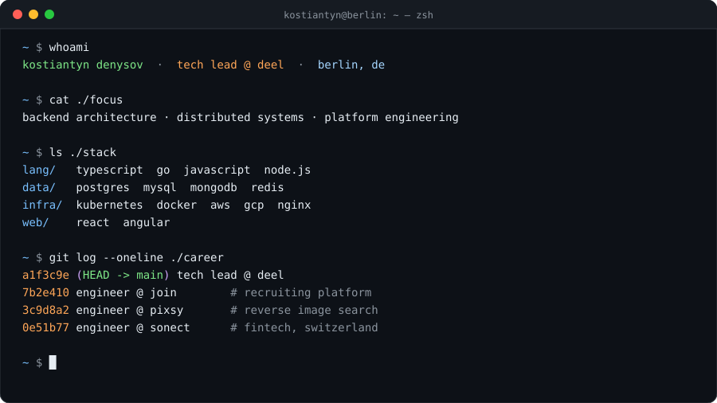

<p align="center">
  
</p>

```go
package kostiantyn

// Ping me about any of these. Coffee in Berlin also works.
var Topics = []string{
	"Node.js internals & performance",
	"Go concurrency patterns",
	"Kubernetes in production",
	"distributed systems & system design",
	"growing engineering teams",
}
```

<p align="center">
  <a href="https://denysov.me/"><code>~/web → denysov.me</code></a>&nbsp;&nbsp;
  <a href="https://www.linkedin.com/in/kostyantyn-denysov-6a889889/"><code>~/social → linkedin</code></a>&nbsp;&nbsp;
  <a href="https://denysov.me/denysov_k_cv.pdf"><code>~/docs → cv.pdf</code></a>
</p>
